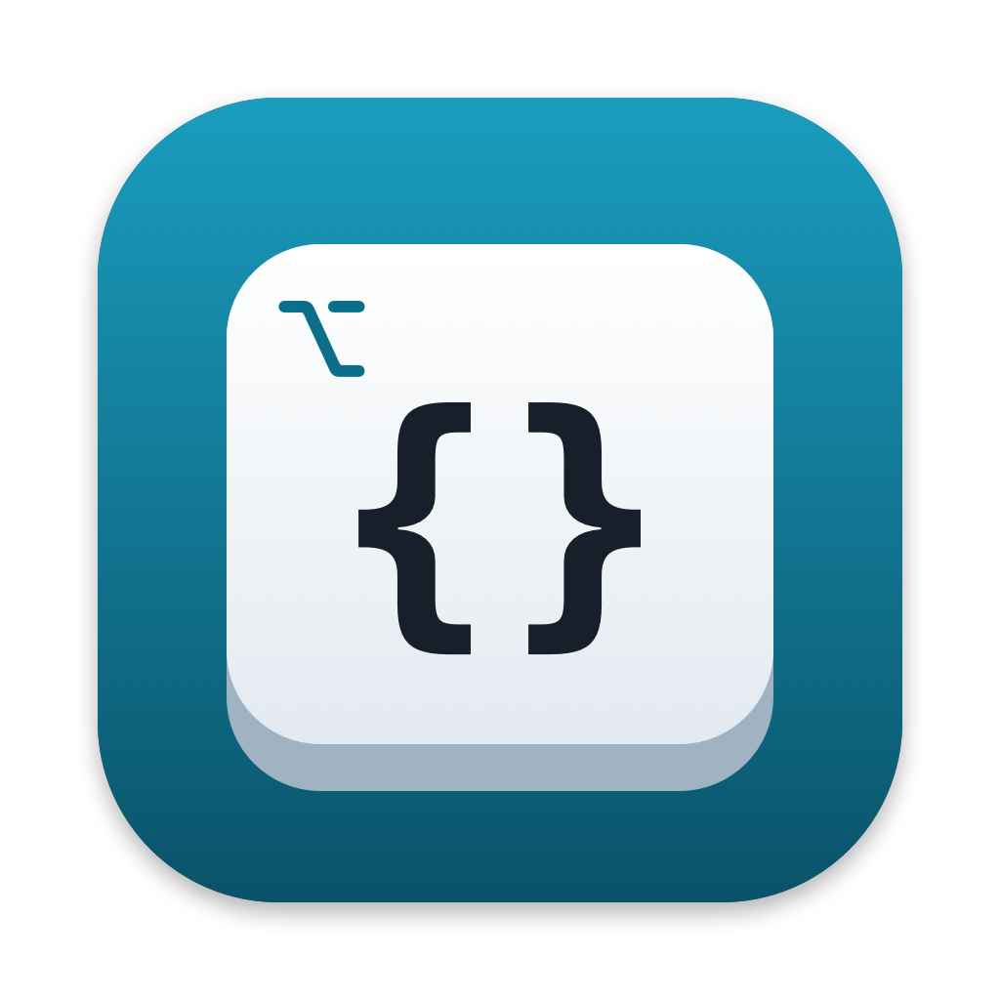
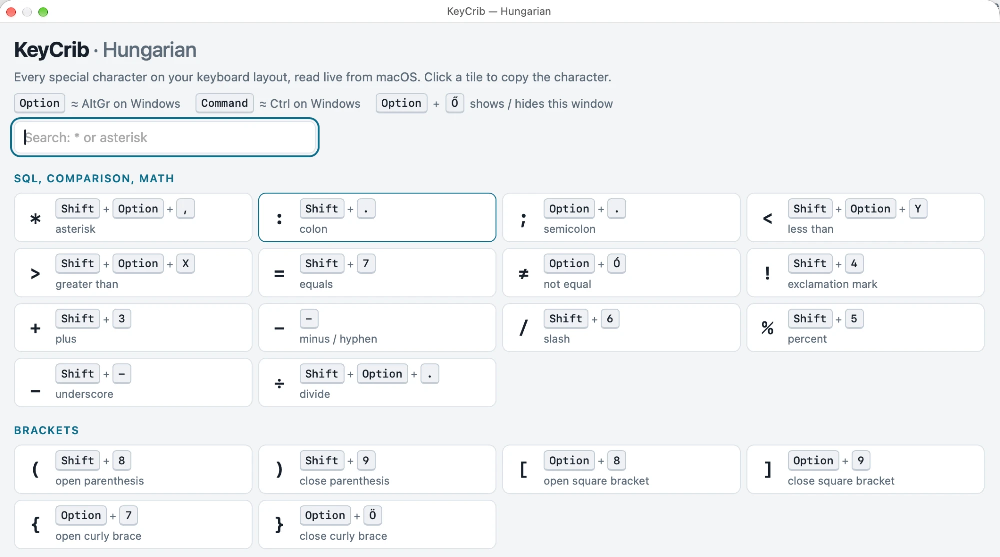

<p align="center"></p>

<h1 align="center">KeyCrib</h1>

<p align="center">A floating cheat sheet for the special characters on your Mac keyboard layout.</p>

<p align="center"> = and brackets"></p>

---

Switched to a Mac from Windows, and now can't find `*`, `:`, `<` `>`, `[` `]`, `{` `}`, `|`, `\` or `@`? On non-US layouts they hide behind Option and Shift + Option, in places nobody would guess.

Press **Option + the key right of P** (Ő on Hungarian, Ü on German, [ on US). KeyCrib pops up a small floating window that shows how to type each character. Press it again, or Esc, to hide it.

- **Reads your actual layout.** The key combinations are not typed in by hand: KeyCrib asks macOS what each key produces on your active layout. It works with Hungarian, German, French, Czech, Polish, Nordic, US and other layouts, and it updates when you switch input sources.
- **Stays on top** while you type in another app, so you can glance at it while you write SQL or code.
- **Click a tile to copy** the character.
- **Search** by character or by name ("pipe", "backslash").
- **Dead keys are marked**, for example "then Space" for `^` on German.
- **Coming from Windows:** a short list of the everyday shortcuts that are different on a Mac.
- **No permissions and no network.** No Accessibility or Input Monitoring access, nothing sent anywhere. It lives in the menu bar with no Dock icon.

## Install

1. Download `KeyCrib.zip` from the [latest release](https://github.com/kntrdzs/keycrib/releases/latest), unzip it, and drag **KeyCrib** to Applications.
2. The first time you open it, macOS says it can't verify the developer, because the app isn't notarized by Apple. Open **System Settings → Privacy & Security**, scroll down, and click **Open Anyway** next to KeyCrib. You only need to do this once.
3. To start it automatically, click the keyboard icon in the menu bar and choose **Open at Login**.

Requires macOS 13 or later. The app runs on both Apple silicon and Intel Macs.

### Build from source

If you'd rather not run a downloaded app, build it yourself. You need the Xcode Command Line Tools (`xcode-select --install`).

```bash
git clone https://github.com/kntrdzs/keycrib.git
cd keycrib
./build.sh
```

The script compiles the app, copies it to `/Applications` and starts it. A self-built app opens without the security warning.

## Customize

- **Characters shown:** edit the `groups` list in `keycrib.html`, then run `./build.sh` again.
- **Hotkey:** change `hotKeyCode` and the modifier in `main.swift`.
- **Icon:** `swift scripts/make-icon.swift` redraws `assets/logo.png` and `assets/AppIcon.icns`.

## License

[MIT](LICENSE)
